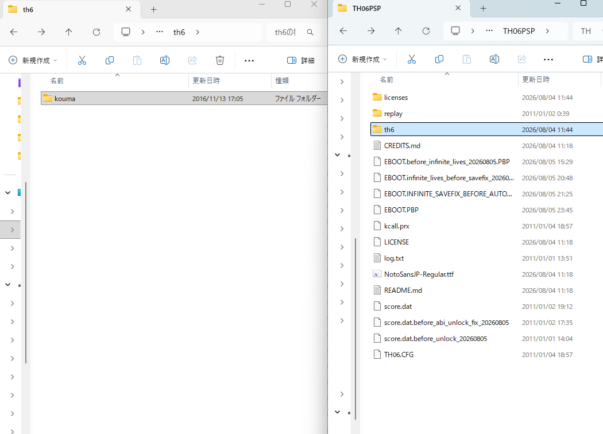
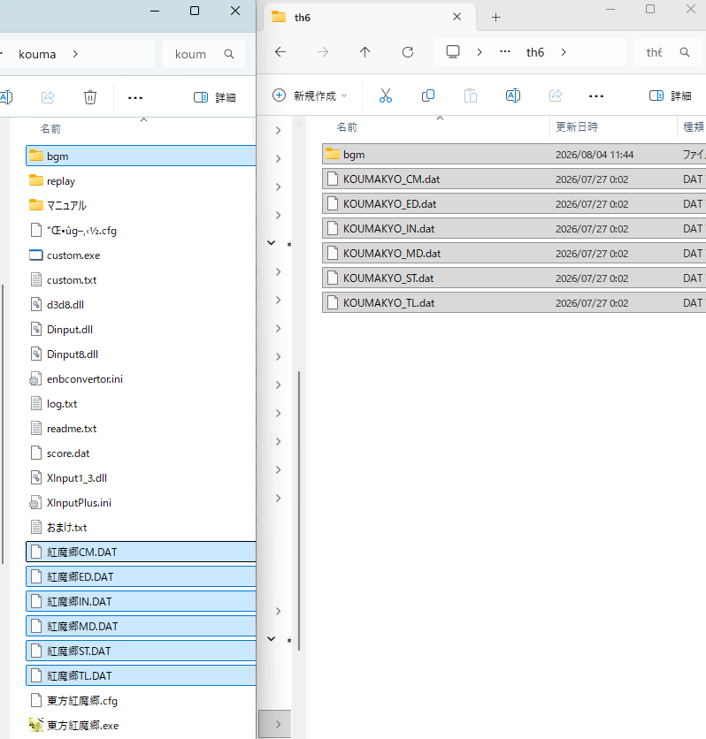

# th06-psp-native

[日本語](README.md) | **English**

An unofficial, work-in-progress native PSP port of Touhou Koumakyou ~ the Embodiment of Scarlet Devil (Touhou 6).
It is not an emulator, and it is unrelated to the older project with the similar name `th06_PSP`.

> [!WARNING]
> This repository and its release EBOOT contain no original Touhou 6 game data.
> You must supply the installed files from your own legally owned PC copy of Touhou 6 version 1.02f.

## What this port does

- It runs the game engine natively on PSP hardware. The PSP backend sends commands through PSPSDK's libGU/libGUM
  directly to the Graphics Engine (GE); it does not use a D3D/OpenGL wrapper.
- On real hardware, PCM audio mixing uses m-c/d's
  [Media Engine Custom Core (MECC)](https://github.com/mcidclan/psp-media-engine-custom-core).
  The Media Engine (ME) is also used for MIDI synthesis. See the MIDI section below for model-specific
  requirements and fallback behavior.
- The original 640x480 game coordinate system is preserved and displayed on the 480x272 PSP screen as either
  `4:3 FIT` with side bars or `FULL STRETCH`.

## Current status

Download the MIDI build: [v1.1.0-preview](https://github.com/kan8223-dotcom/th06-psp-native/releases/tag/v1.1.0-preview).

The 2026-10-15 preview supports real-time MIDI playback using your own `gm.dls`.
Main-CPU busy polling during ME completion waits was removed; waiting now yields CPU time to the game.

PSP-1000 hardware logs from the MIDI development build before that wait change confirm stages 1–6, the ending,
result screen, return to title, and score save. Logs from the current build cover play into stage 5 and return to
title; the user reports more responsive play. The user also reports completing a full run with the current build
on PSP-3000. These results do not guarantee 60 fps, uninterrupted audio, or exact Windows MSGS reproduction.

This is still a preview, not a finished port. Known limitations include:

- GE optimization is incomplete. Busy backgrounds, portraits, and large bullet clears can make the frame rate
  drop to 30 fps or below.
- Short stalls during Memory Stick reads can still occur.
- Optional MIDI uses your own `gm.dls`; see the setup below. Audio interruptions are not fully resolved:
  the current build's hardware log still records a PCM underrun in the stage 4 interval.
- Real-time MIDI playback reduces gameplay performance. Using the ME does not eliminate the synthesis overhead,
  and additional slowdown may occur. Select WAV BGM if gameplay performance is your priority.
- PSP Go data discovery has been tested in PPSSPP, but switching between `ef0:` internal storage and a real
  Memory Stick Micro has not yet been verified on PSP Go hardware.
- PPSSPP success does not guarantee compatibility with real PSP hardware.
- Back up existing score, configuration, and replay files. Their compatibility and integrity are not guaranteed.

Release history is in [CHANGELOG.md](CHANGELOG.md). Further MIDI setup notes and test boundaries are in
[docs/53-midi.md](docs/53-midi.md).

## What you need

- A PSP that can run homebrew through custom firmware (CFW).
- The release ZIP from this repository's [Releases page](https://github.com/kan8223-dotcom/th06-psp-native/releases).
- The installed folder from your own PC copy of Touhou 6 version 1.02f.
- A way to copy files to the PSP, such as USB mode or a memory-card reader.

The installed PC folder must contain all six original DAT archives and the 17 WAV files named
`bgm/th06_01.wav` through `bgm/th06_17.wav`. Copy the installed folder, not merely the Windows installer.

This project does not provide the original game, original data, or instructions for obtaining them or CFW.

## CFW compatibility notes

The following notes concern earlier releases, not a full CFW compatibility retest of this MIDI build.

- **PSP-1000 / 6.60 PRO-B10:** the released v1.0.0 build was reproduced crashing after stage 2.
  With the v1.0.1 fixes, a PSP-1000 hardware run successfully transitioned through stages 1 to 6.
- **6.61 PRO CFW:** a similar post-stage-2 crash was reported with a v1.0.0-era build. The v1.0.1 fixes have not
  yet been retested on this CFW.
- **6.61 LME and ARK-5:** no equivalent report has been received, but this is not comprehensive compatibility proof.

Not every combination of PSP model, CFW version, and CFW setting has been tested.

## Installation

Use this recommended layout first. It is the simplest to troubleshoot.

1. Extract the release ZIP on your PC.
2. Copy the entire extracted `TH06PSP` folder to `PSP/GAME/` on the Memory Stick, or to the corresponding folder
   on PSP Go internal storage if that is where you run homebrew.
3. Copy your entire installed Touhou 6 PC folder into `PSP/GAME/TH06PSP/`.
4. Rename only that copied folder to the short ASCII name `th6`. Do not rename or select individual files inside it.
5. Safely eject the PSP or memory card, then open Game on the XMB and launch `Touhou 6 PSP Native`.

The first image shows the source PC folder (named `kouma` in the example) being copied into `TH06PSP` and renamed
to `th6` at the destination.



The resulting layout should look like this:

```text
PSP/GAME/TH06PSP/
├── EBOOT.PBP
├── NotoSansJP-Regular.ttf
├── msgothic.ttc                 <- optional MS Gothic; supply your own (not included)
├── README.md
├── README_EN.md
├── CREDITS.md
├── LICENSE
├── licenses/
└── th6/                         <- your own copied PC installation folder
    ├── 東方紅魔郷.exe
    ├── 紅魔郷CM.DAT
    ├── 紅魔郷ED.DAT
    ├── 紅魔郷IN.DAT
    ├── 紅魔郷MD.DAT
    ├── 紅魔郷ST.DAT
    ├── 紅魔郷TL.DAT
    ├── gm.dls                   <- optional; supply your own for MIDI
    └── bgm/
        ├── th06_01.wav
        └── ... th06_17.wav
```

To use MS Gothic, optionally copy `C:\Windows\Fonts\msgothic.ttc` from your own Windows installation to
`PSP/GAME/TH06PSP/msgothic.ttc`, beside `EBOOT.PBP`. MS Gothic is tried first; if it is missing or cannot be
loaded, the included `NotoSansJP-Regular.ttf` is used instead. This Microsoft font is not included; do not
upload it to GitHub or attach it to issue reports.

This image shows the six DAT files in the original PC installation folder:



> [!NOTE]
> The `KOUMAKYO_*.dat` names on the right side of the image were used for a development test and are also accepted.
> Current builds can use the original Japanese filenames shown on the left. You do not need to rename the DAT files.

If the PSP FAT driver cannot open a Japanese DAT filename directly, the port identifies it by its version-specific
file size and `PBG3` header. If any of the six DAT archives or 17 WAV files is missing, the game does not start;
the boot screen reports the missing counts and returns to the XMB after about 15 seconds. You can also press X or
START to leave that screen.

### Optional automatic data-folder discovery

Instead of placing the PC folder inside `TH06PSP`, you may place it directly below the root of a Memory Stick or
PSP Go internal storage. The folder itself may have any name. For example:

```text
ms0:/kouma/    <- Memory Stick, or Memory Stick Micro on PSP Go
ms0:/th6/
ef0:/kouma/    <- PSP Go internal storage
ef0:/th6/
```

A valid saved choice takes priority. Without one, the port checks the `th6` folder beside the EBOOT, the EBOOT folder
itself for legacy flat layouts, then the root and immediate subdirectories of the device from which the EBOOT was
launched, followed by the other `ms0:`/`ef0:` device. It does not recursively scan the whole device. A folder is
accepted only when all six DAT sizes and `PBG3` headers match Touhou 6 1.02f and all 17 WAV files are present.

To choose among detected folders, hold SELECT while launching the game. Select `AUTO` or a path with Up/Down,
then press X or START to save it; Circle cancels. The choice is saved as
`PSP/GAME/TH06PSP/TH06PSP_DATA_PATH.TXT`. If that storage is removed or the folder is moved, the next launch falls
back to automatic search. Choosing `AUTO` clears the saved override.

The original data folder is treated as read-only. Configuration, score data, new replays, and engine logs are kept
under the EBOOT's `TH06PSP` folder instead.

## Controls

| PSP control | Action |
|---|---|
| D-pad or analog stick | Move; navigate menus |
| X | Shoot; confirm |
| Circle | Bomb; go back/cancel |
| Square, L, or R | Focus/slow movement while held |
| Triangle | Skip dialogue when skipping is allowed |
| START | Pause/open the in-game menu; also confirms a boot data-folder choice |
| SELECT held during launch | Open the data-folder selector |
| HOME | Open the PSP system exit dialog |

If the game stops responding, hold **L + R + START for about one second** to request an emergency return to the XMB.
Try this before forcing the PSP to power off.

In Options, use the screen-mode row to choose `4:3 FIT` or `FULL STRETCH`. MIDI BGM is available when the optional
instrument file described below is present and the MIDI backend is available.

## Optional MIDI: use your own MSGS instrument file

**Copy your own `gm.dls` to the Memory Stick, then select MIDI in the title screen's Option menu.**
The PSP synthesizes the songs using the instruments from Microsoft GS Wavetable Synth (MSGS).
It does not run the Windows MSGS program, and exact reproduction is not guaranteed.

Real-time MIDI playback reduces gameplay performance. Using the ME does not eliminate the synthesis overhead,
and additional slowdown may occur. Select WAV BGM if gameplay performance is your priority.

1. Find `C:\Windows\System32\drivers\gm.dls` on your own Windows PC.
2. Copy it, unrenamed, to `PSP/GAME/TH06PSP/th6/gm.dls`. If you use another original-data folder,
   put it directly inside that selected folder instead.
3. Start the game. The first boot automatically builds `PSP/GAME/TH06PSP/MIDICACHE.BIN` (about 1.2 MB)
   with the instruments needed by the original MIDI songs. The first boot takes longer.
4. Set BGM to MIDI in Option.

Keep `gm.dls` even after the cache is created. All six original DAT archives and all 17 WAV tracks are still required.
No SF2 file or Windows MSGS executable is required.
If an old cache remains after replacing the instruments, remove `MIDICACHE.BIN` and restart to rebuild it.

Without usable instruments/backend, BGM falls back to WAV. PSP-1000 requires the ME for MIDI;
PSP-2000/3000 and later models also have a main-CPU synthesis fallback, without a performance guarantee.
The normal release EBOOT has no automatic controls, invulnerability, or unattended-test exit.

`gm.dls` is Microsoft's copyrighted instrument file. Neither it, instrument/waveform data, its generated cache,
nor the original MIDI songs are included. Supply your own file and do not upload these files to the repository
or attach them to issue reports.

## If something goes wrong

First check the install tree and make sure the boot screen reports `DAT6/6 WAV17/17`. A count below that means the
selected original-data folder is incomplete or is not Touhou 6 1.02f.

The port keeps diagnostic files in two places:

| File | What it contains |
|---|---|
| `<launch device>:/TH06PSP_BOOT.LOG` | The current launch and the latest stage/runtime breadcrumbs |
| `<launch device>:/TH06PSP_BOOT_PREV.LOG` | One preserved previous launch |
| `PSP/GAME/TH06PSP/log.txt` | Engine-level file or asset errors, when one was written |

`<launch device>` is the storage from which the EBOOT actually ran: normally `ms0:` for a Memory Stick or `ef0:`
for PSP Go internal storage. On a PC these first two files appear at the root of that mounted drive, not inside
`PSP/GAME/TH06PSP`.

Copy the logs to your PC before repeatedly launching the game; only one previous boot log is retained. When filing
an [Issue](https://github.com/kan8223-dotcom/th06-psp-native/issues), include:

- the release version or the `BUILD` line near the start of `TH06PSP_BOOT.LOG`;
- the PSP model, system software, and CFW name/version;
- the character, difficulty, stage, and exact action immediately before the problem;
- whether the PSP returned to the XMB, froze, showed a CFW crash screen, or lost power, including battery state;
- `TH06PSP_BOOT.LOG`, `TH06PSP_BOOT_PREV.LOG`, and `log.txt` if present.

Do not upload original DAT/WAV files, your original executable, or other copyrighted game data.

For normal play, do not create `TH06PSP_DIAG.ON`. If a maintainer specifically requests a detailed measurement,
place an empty file with that name beside `EBOOT.PBP`, reproduce the issue once, collect the logs, and remove the
marker. Detailed logging adds Memory Stick I/O and can affect timing and performance.

For a more technical explanation of boot-log lines, see
[docs/51-boot-diagnostics.md](docs/51-boot-diagnostics.md) (currently written in Japanese).

## Not included

The repository and release package do not include:

- the Touhou 6 EXE, DAT, WAV, images, music, or any other original game data;
- original or development replays (`.rpy`);
- score, configuration, log, or other user data;
- `TH06PSP_DATA_PATH.TXT`;
- Microsoft fonts;
- `gm.dls`, its generated `MIDICACHE.BIN`, or original MIDI songs.

The release does not ship a populated `replay/` folder. The game creates and uses it on your own storage when needed.

## Unofficial-project notice

This project is not an official product of Team Shanghai Alice or ZUN, and it is not endorsed, supported, or
warranted by them. Do not contact Team Shanghai Alice, ZUN, GensokyoClub, m-c/d, PSPDEV, PPSSPP, or maintainers of
the referenced projects for support with this port.

If support is available, use only this repository's
[Issues](https://github.com/kan8223-dotcom/th06-psp-native/issues). Requests for the original game, CFW acquisition,
or sharing original game data are out of scope.

## Building from source

For developers, install PSPDEV/PSPSDK at `/usr/local/pspdev` and make sure CMake, Python, and `xxd` are available.
The bundled m-c/d MECC source is built automatically on the first `make`.
The shared MIDI synthesizer and sequencer sources are bundled in `third_party/touhou_dls_common`.
Building the program does not require a separate local checkout or any instrument file.

```sh
make -j"$(nproc)" all
./psp_preflight.sh --post
make release
```

`make release` creates `dist/th06-psp-native-preview.zip`. It packages selected program, documentation, font, and
license files only; the release audit rejects original game data, replays, scores, and test-only EBOOT markers.

## Credits and license

Implementation sources and referenced repositories are documented with their URLs and uses in
[CREDITS.md](CREDITS.md).

This project's own code follows the GNU General Public License v3.0 used by the portable branch of
[GensokyoClub/th06](https://github.com/GensokyoClub/th06). See [LICENSE](LICENSE). Bundled third-party components
and fonts retain their respective licenses. Rights to the original game data are outside this license.
